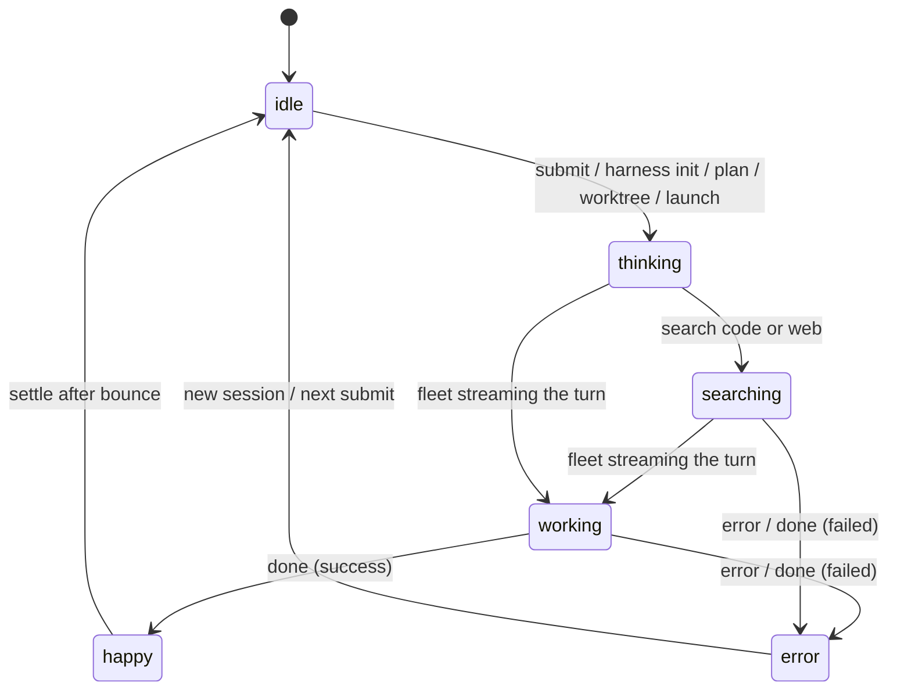
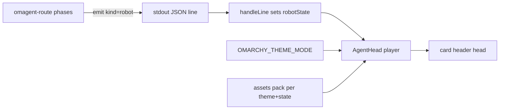

**Target repo:** soham.omagent. All paths below are relative to the plugin root.

## Goal Capsule

- **Objective:** An observer can tell what omagent's code mode is doing at a glance — idle, thinking, searching, working, error, or done — from an animated head on the overlay, without slowing the desktop.
- **Means:** Bake six state loops offline from the robot-heads library and play them as a lightweight in-shell image animation bound to the router's status (KTD1, KTD2, KTD3).
- **Authority hierarchy:** Requirements (R…) win on product behavior. Key Technical Decisions (KTD…) win on mechanism within the constraints of the Rs they cite. Units implement neither; they carry unit-local deltas only.
- **Stop conditions:** Stop if the overlay fails to reload cleanly after the change; if offline baking cannot produce the six states; or if playback shows a measurable GPU/CPU regression on the target integrated-GPU hardware.
- **Execution profile:** Primarily QML (`Omagent.qml`), a small Python emitter (`omagent-route`), and an offline Node baker (`tools/bake-heads/`) whose only shipped output is a folder of image assets.
- **Tail ownership:** After implementation, reload the shell and run a live code-mode turn in both themes; confirm reduced-motion and hidden states cost nothing; keep the offline baker and scratch out of the shipped plugin.

## Product Contract

### Summary

Add an animated robot-head status indicator to the code-mode pill that reflects the harness phase at a glance. Six looping heads are baked once offline from the robot-heads library and played as a lightweight, theme-aware image animation, driven by a coarse state the router emits on its existing event channel.

### Problem Frame

Omagent's code mode fans a request out to the Herdr + Firstmate + Antigravity fleet, whose phase (initializing, checking a worktree, launching, planning, searching, streaming) is currently only readable from scrollback status lines. The overlay already carries a precise run/mode machine (`runState`, `mode`, and the router's phase strings), so the head can be an accurate, glanceable mirror of "what the agent is doing." Two constraints shape it: the user wants motion, not a static icon, and the target is an 8 GB machine with an Intel Iris Xe shared GPU, so the head must animate cheaply. Rendering the "3D" heads in a browser or a native Canvas inside the shell would be heavy; baking their motion to image loops and replaying it as a texture is visually equivalent for state-driven animation at a fraction of the cost.

### Requirements

Status semantics

- R1. The head shows one discrete robot state for the current code-mode phase, drawn from the six-state set (idle, thinking, searching, working, error, happy) per the phase-to-state mapping.
- R2. A code-mode run moves the head idle → thinking → searching → working, then happy on success or error on failure, and it settles to idle on session reset and after the success bounce.
- R3. The head reflects the latest router phase within one emitted event, with no stale pose after a transition.

Rendering and performance

- R4. The head animates from looping frames baked once offline; the overlay loads them as images, with no WebGL, no browser engine, and no canvas at runtime.
- R5. Playback is cheap on shared-GPU hardware: small frames, a capped frame rate, a calm idle, motion paused while the pill is hidden, and still poses honored under reduced-motion or an explicit pause.
- R6. The head ships one asset set per theme (light and dark), swaps on theme change, and stays legible on the overlay background.

Integration

- R7. The code-mode state rides the existing router-to-overlay JSON-line channel; the router emits it and the overlay consumes it, with no new process or transport.
- R8. The head sits in the card header status area and does not disturb the pill input row, the mode badge, or card text.
- R9. The overlay gains no runtime dependency; the baker runs offline and only image assets ship inside the plugin.

### Key Decisions

- KD1. **Six-state set** — chosen over a finer set that splits working into startup vs. fleet-busy and adds a steering/listening pose. Governs R1, R2. Matches the six real phases and keeps assets and mapping small; finer states are deferred.
- KD2. **Card-header placement** — chosen over a pill-row companion or replacing the logo mark. Governs R8. Visible throughout a run and the least disruptive to the input row.
- KD3. **Per-theme asset swap** — chosen over a single theme-neutral set. Governs R6. Crisper on both palettes; the assets are small enough to duplicate per theme.

### Key Flows

- F1. Code-mode status to head
  - **Trigger:** The user submits a code-mode request.
  - **Steps:** The router transitions phase and emits a `robot` state (thinking → searching → working). The overlay's `handleLine` sets `robotState`; the player swaps to that state's loop and plays while the pill is visible. On completion the router emits `happy` (success) or `error`.
  - **Outcome:** The head always reflects the current phase.
- F2. Theme swap
  - **Trigger:** The OS theme toggles light/dark.
  - **Steps:** The overlay re-resolves the theme and the player rebinds its image sources to the other theme's set.
  - **Outcome:** The head stays correct and legible per theme.
- F3. Hidden or reduced-motion
  - **Trigger:** The pill is hidden, or reduced-motion is set, or playback is paused.
  - **Steps:** The frame timer stops and the head holds its last frame (or a still pose).
  - **Outcome:** Zero animation cost while hidden; stills honored under reduced-motion.

### Acceptance Examples

- AE1. Given a code-mode request is submitted, when the harness is initializing or planning, then the head shows the thinking loop.
- AE2. Given the run reaches search (code or web), when the router emits that phase, then the head shows the searching loop with its scanning beam.
- AE3. Given the fleet is streaming the turn, when status/text rows stream, then the head shows the working loop with its progress bar.
- AE4. Given the run finishes successfully, when the done(success) event arrives, then the head plays the happy bounce and settles to idle.
- AE5. Given the run fails or errors, when the error event arrives, then the head shows the error loop until the next action or session reset.
- AE6. Given the pill is hidden or reduced-motion is set, when the run continues, then the head does not animate (zero cost) and, under reduced-motion, shows a still pose.

### Success Criteria

- SC1. After each code-mode phase change, the head shows the mapped state — the acceptance signal for R3.
- SC2. A running code-mode turn animates the head with no perceptible overlay lag, adding at most a few MB of texture memory and negligible CPU.
- SC3. Hidden, paused, and reduced-motion states cost nothing and render correct stills.
- SC4. No regression to existing pill behavior (input, mode switch, card, notifications) after a shell reload.

### Scope Boundaries

- **In scope:** Code mode. The head defaults to idle for local/web modes; their dedicated animation mapping is not styled here.
- **Deferred to Follow-Up Work:**
  - Per-token or fine-grained live reactions. robot-heads animates by discrete state only; it has no live-data input.
  - A native QML Canvas rewrite for a dependency-free, first-class head in the shell.
  - Dedicated head animation for local/web modes.
  - Interactive poke/click affordances (head follow or hop on click) inside the overlay.
  - The optional steering/listening pose and a finer working split, unless later requested.

### Sources

- robot-heads library (React 2D-canvas heads; the bake input): github.com/fayazara/robot-heads, MIT. Its `state` vocabulary (idle, thinking, searching, working, happy, error) and `paused`/determinism options are the mapping and bake levers.
- Quickshell 0.3.1 runs Qt6 QML: `AnimatedSprite`/`SpriteSequence` were removed in Qt6 and `AnimatedImage` (QMovie/GIF) remains. The player therefore advances an `Image` with a frame `Timer` (primary), with a GIF fallback.
- Router-to-overlay seam: `omagent-route` `emit(kind, …)` prints one JSON object per line; `Omagent.qml` `handleLine` dispatches on `kind` and owns `runState`.
- Theme signal: `OMARCHY_THEME_MODE` is already used as a fallback in `omagent-harness-view`; the shell exposes it, and QML reads env via `Quickshell.env`.

## Planning Contract

### Key Technical Decisions

- KTD1. Render the heads by baking looping frames offline from robot-heads and replaying them as images in the shell (session-settled: user-approved — chosen over a live in-shell browser window and a native QML Canvas rewrite: the heads animate by state only, so a baked loop is visually identical at a fraction of the cost, and a resident browser would tax the integrated GPU). Governs R4, R5, R9.
- KTD2. Animate continuously per state (loops), not static per-state poses (session-settled: user-directed — chosen over still images because the user asked specifically for animation). Governs R1, R4.
- KTD3. Bake at low settings — roughly 128px frames, 15–20 fps, short loops, a near-static idle, and one spritesheet per state per theme (session-settled: user-approved — chosen over higher-fidelity settings to protect the 8 GB / integrated-GPU budget). Governs R5.
- KTD4. The router emits a coarse `robot` state on its existing stdout channel and the overlay stores it on a `robotState` property the player binds to — chosen over classifying phase strings inside QML, so the phase knowledge stays with the router that already has it. Governs R7.
- KTD5. Resolve theme from `Quickshell.env("OMARCHY_THEME_MODE")`, falling back to the shell theme singleton and then a neutral set — chosen to avoid coupling to shell internals. Governs R6.

### High-Level Technical Design

The mapping from code-mode phases to the six states is the contract shared by the baker (U1) and the router emitter (U2). Values shown are the defaults from KD1.

The full phase-to-state mapping:

| Code-mode phase (router) | Robot state |
| --- | --- |
| idle / new session / restored | idle |
| submit, "Initializing Herdr workspace…", "Launching Antigravity harness…", "Analyzing request & planning steps" | thinking |
| "Firstmate: Checking Treehouse worktree pool…" | thinking |
| "Searching codebase…", "Searching code/web: …" | searching |
| fleet streaming the turn (status/text/tool while running) | working |
| done (success) | happy |
| error, done (failed), router exit | error |

The data path is short and reuses existing machinery — no new transport:

### Risks

- Theme resolution: `OMARCHY_THEME_MODE` may not be present in the Quickshell environment. Mitigation: prefer the shell's theme singleton, fall back to the env var, then a neutral set (KTD5); verify during U4/U5 and keep the neutral set as the guaranteed fallback.
- Bake determinism: loop frames must be stable so re-bakes never shimmer. Mitigation: fix the robot-heads `seed` and `speed` and capture a bounded loop; U1 asserts byte-identical re-runs.
- Shared-GPU budget: a per-frame `Timer` and texture swaps must not tax the Iris Xe. Mitigation: capped fps, one spritesheet per state resident only while active, motion paused while hidden (KTD3, R5); U5 measures before/after during a live run.
- Fragile shell iteration: the overlay is `keepLoaded`, so QML/asset edits need `omarchy restart shell` to take effect. Mitigation: treat reload + `journalctl` as part of every verification step.
- Missing asset: a state without a spritesheet must not show a broken image. Mitigation: fall back to the idle still frame (U3/U5).

### Dependencies

- robot-heads (build-time only, via the offline baker) and Playwright/Chromium for headless capture.
- The installed shell runtime (Quickshell 0.3.1) and the agent fleet toolchain already used by code mode; no new runtime dependency is introduced (R9).

## Implementation Units

### U1. Phase-to-state mapping and baked head assets (offline baker)

- **Goal:** Produce looping per-state spritesheets for the six states in both themes, plus the canonical phase-to-state mapping.
- **Requirements:** R1, R2, R4; applies the KTD3 bake settings.
- **Dependencies:** None (first).
- **Files:** `tools/bake-heads/` (offline Node harness that mounts robot-heads; not shipped) and its output `assets/heads/<theme>/<state>` spritesheets.
- **Approach:**
  1. Build a minimal React page mounting `<RobotHead state=… shape="rectangle" size=128 floorShadow={false}>` that exposes its canvas frames.
  2. Drive the page headless with Playwright to capture a bounded loop of frames per state per theme at 15–20 fps, with a fixed `seed` and `speed` for determinism.
  3. Pack each `(theme, state)` into a single spritesheet; bake shell color to match the overlay palette per theme.
  4. Emit the canonical phase-to-state mapping (the HTD table above) as the reference U2 and U3 implement against.
- **Execution note:** This is offline tooling — prefer asset determinism and visual smoke over unit coverage.
- **Patterns to follow:** robot-heads usage from its README (`state`, `paused`, `floorShadow`, `seed`).
- **Test scenarios:**
  - Rendering each of the six states in both themes yields a non-empty spritesheet with the expected frame count and dimensions.
  - Re-running the offline baker with the same seed reproduces byte-identical frames, so re-bakes never shimmer.
  - The idle spritesheet is the calmest (fewest changed pixels across its loop), confirming the lean-idle intent.
- **Verification:** The baker emits assets for six states × two themes, and each head renders legibly.

### U2. Emit a coarse robot-state signal from the router

- **Goal:** Emit `{"kind":"robot","state":…}` at code-mode phase transitions for the overlay to bind to.
- **Requirements:** R1, R2, R3, R7.
- **Dependencies:** U1 (mapping).
- **Files:** `omagent-route`.
- **Approach:**
  1. Add a small pure classifier that maps the router's own phase signals to the six states per the U1 mapping.
  2. Emit through the existing `emit("robot", state=…)` at each transition; emit `idle` on new session/restore and `happy`/`error` on completion.
  3. Emit only on state change, so a stream of same-phase rows produces one `robot` line.
- **Execution note:** Confirm the emitted `robot` lines before wiring the UI.
- **Patterns to follow:** The existing `emit(kind, …)` helper and the code-mode phase strings.
- **Test scenarios:**
  - Driving the classifier directly with the representative phrase from each mapping row returns that row's state.
  - Repeating the same phase does not emit a duplicate `robot` line (change-only emission).
- **Verification:** A direct harness over the classifier returns the mapped state for every row of the phase-to-state mapping, and `OMAGENT_DRY_RUN=1 omagent-route --mode code …` shows the early-phase `robot` lines on stdout.

### U3. Animated head player (QML)

- **Goal:** A reusable, lightweight element that plays a state's spritesheet and is driven by a state string.
- **Requirements:** R4, R5, R6, R9.
- **Dependencies:** U1 (assets).
- **Files:** `Omagent.qml` (an inline `AgentHead` component).
- **Approach:**
  1. Add an element holding the current frame source and a `Timer` at the target fps advancing the frame index modulo the loop length; the timer runs only while the head is visible, active, and not reduced-motion.
  2. Resolve the source path from theme + state + frame index under `assets/heads/<theme>/…`.
  3. Hold the last frame (or a still) while hidden or under reduced-motion; fall back to the idle still when a state's asset is missing.
- **Execution note:** QML has no unit-test harness here — prefer runtime smoke in the overlay.
- **Patterns to follow:** The existing `Image` usage and the `Quickshell.env` precedent.
- **Test scenarios:**
  - Given state = working and the pill visible, the player advances through the working frames at the target fps.
  - Given the pill hidden, the timer stops and the last frame is held (zero animation cost).
  - Given light theme, sources resolve under the light set; a theme change rebinds sources.
  - Given reduced-motion, a still pose is shown instead of animating; a missing state asset falls back to the idle still.
- **Verification:** In the overlay, toggling state/theme/visibility behaves as above with no QML errors under `journalctl --user | grep omagent`.

### U4. Wire the head into the overlay

- **Goal:** Connect the router's `robot` events to the player, place the head in the card header, and settle it to idle.
- **Requirements:** R3, R7, R8, and the settle behavior in R2.
- **Dependencies:** U2, U3.
- **Files:** `Omagent.qml`.
- **Approach:**
  1. Add a `robotState` property; handle `kind === "robot"` in `handleLine` to set it; reset to idle on new session and after the happy bounce settles.
  2. Place the `AgentHead` in the card header status area, sized small, beside the status line.
  3. When the pill is hidden, settle `robotState` to idle so only the idle spritesheet is ever resident; the player then holds its frame per U3.
- **Patterns to follow:** The existing `runState` property, `save()`/restore, and `handleLine` dispatch.
- **Test scenarios:**
  - A full code-mode run advances `robotState` idle → thinking → searching → working → happy, and the header head follows.
  - A failed run shows the error head and holds it until the next submission or session reset.
  - Opening the pill after a finished run shows idle, not a stale pose.
  - Existing behavior is unchanged: input submit, Ctrl+T mode switch, mode badge, card text, and the background-completion notification.
- **Verification:** End-to-end ALT+SPACE code-mode runs in both themes track the phases with no regressions, picked up by `omarchy restart shell`.

### U5. Bake into the overlay and verify performance and accessibility

- **Goal:** Place the assets and confirm the head is light, theme-correct, reduced-motion-aware, and degrades gracefully.
- **Requirements:** R5, R6, SC2, SC3.
- **Dependencies:** U1, U4.
- **Files:** `assets/heads/…`.
- **Approach:**
  1. Run the offline baker (U1) and place its output under `assets/heads/`.
  2. Verify lightness, reduced-motion stills, and missing-asset fallback during a live run.
- **Test scenarios:**
  - A running code-mode turn shows the intended head while adding at most a few MB of texture memory and negligible CPU (measured before vs. during a run).
  - Reduced-motion and paused states render correct stills in both themes.
  - A deliberately missing state asset degrades to the idle still, with no broken-image artifact.
- **Verification:** Measurements during a live run satisfy SC2; reduced-motion, hidden, and fallback behaviors all pass.

## Verification Contract

This plugin has no unit-test runner; QML and the router are verified with the repo's own runtime tooling.

- Reload the shell after QML/asset changes: `omarchy restart shell` (the overlay is `keepLoaded`, so a restart is required to pick up changes).
- Router robot events: a direct check over the classifier returns the mapped state for every row of the mapping, and `OMAGENT_DRY_RUN=1 omagent-route --mode code …` shows the early `robot` lines on stdout (U2).
- Offline baker: run the Node harness in `tools/bake-heads/` and assert it emits one spritesheet per state per theme (U1).
- Overlay health: `journalctl --user -f | grep -i omagent` during a run and a theme toggle — expect no QML errors (U3, U4).
- Live acceptance: ALT+SPACE code-mode run in dark and light; confirm the head tracks phases, hidden/reduced-motion cost nothing, and missing assets fall back to idle (U4, U5).

## Definition of Done

Global

- The head tracks every code-mode phase via the router's `robot` signal, plays only while visible and active, honors reduced-motion and theme, and adds no runtime dependency to the shell (R1–R9).
- Assets exist for six states × two themes, and a missing asset falls back to the idle still.
- No regression to existing pill behavior after `omarchy restart shell`.
- The offline baker and any experimentation scratch are removed or kept out of the shipped plugin; only `assets/` and the code changes remain, and no dead-end bake code is left behind.

Per unit

- U1: six-state × two-theme spritesheets produced and deterministic on re-run.
- U2: each phase emits exactly one correctly-mapped `robot` line, change-only.
- U3: the player advances, holds when hidden, rebinds on theme change, and falls back to idle.
- U4: end-to-end phase tracking in the header with no regressions.
- U5: measured lightness meets SC2, and reduced-motion, hidden, and fallback behaviors pass.
